# Knowly — 浏览器 AI 伴学

Knowly 是一个 Chrome 扩展。你可以在网页中选中不熟悉的概念，直接查看 AI 解释、继续追问、添加自己的笔记，并将学习卡片导出为 Markdown。

## 功能

- 划词后在选区附近打开解释卡片。
- 支持 DeepSeek、智谱 GLM 和豆包，可在扩展选项中配置模型。
- 解释支持逐步显示；卡片内可以继续追问并记录个人笔记。
- “同时发送所在句子”默认关闭，需要上下文时可手动开启。
- 待保存清单支持收集多张卡片、更新已有卡片、移除卡片及合并导出。
- Markdown 文件包含选中内容、AI 解释、追问、个人笔记和来源信息。
- 卡片可拖动和调整尺寸。待保存清单保存在当前浏览器中。

## 安装与使用截图

以下截图按实际操作顺序展示 Knowly 的本地安装、模型配置、卡片使用与 Markdown 导出过程。截图中的 API Key 已遮蔽；使用者需要在自己的浏览器扩展设置中填写 Key。

### 1. 从 Chrome 打开扩展管理页

打开 Chrome 菜单，进入“扩展程序”，再选择“加载未打包的扩展程序”。

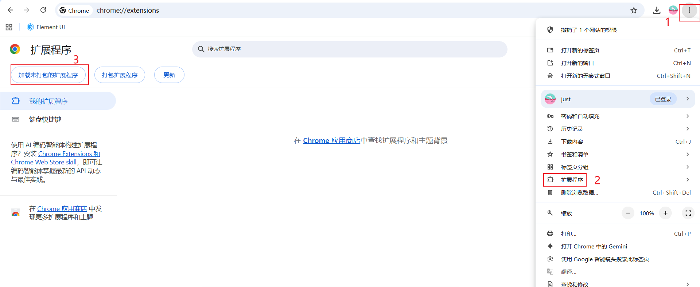

### 2. 选择已构建的扩展目录

在文件夹选择窗口中，选择包含 `manifest.json` 的 `chrome-mv3` 目录，然后确认。

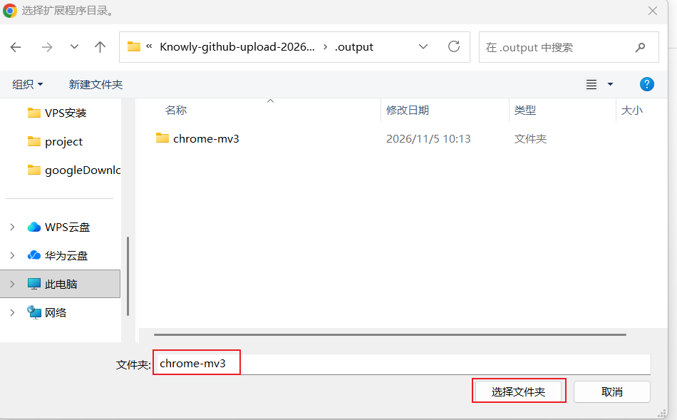

### 3. 确认 Knowly 已加载

扩展管理页出现 Knowly 卡片，且扩展开关已启用，即表示本地加载完成。

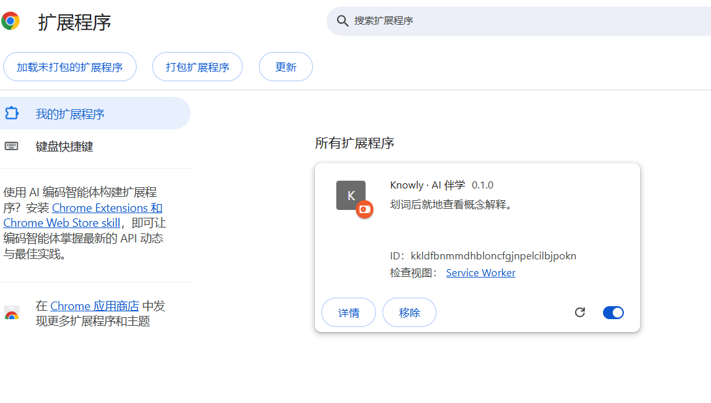

### 4. 打开扩展详情

在 Knowly 卡片上点击“详细信息”，进入扩展设置。

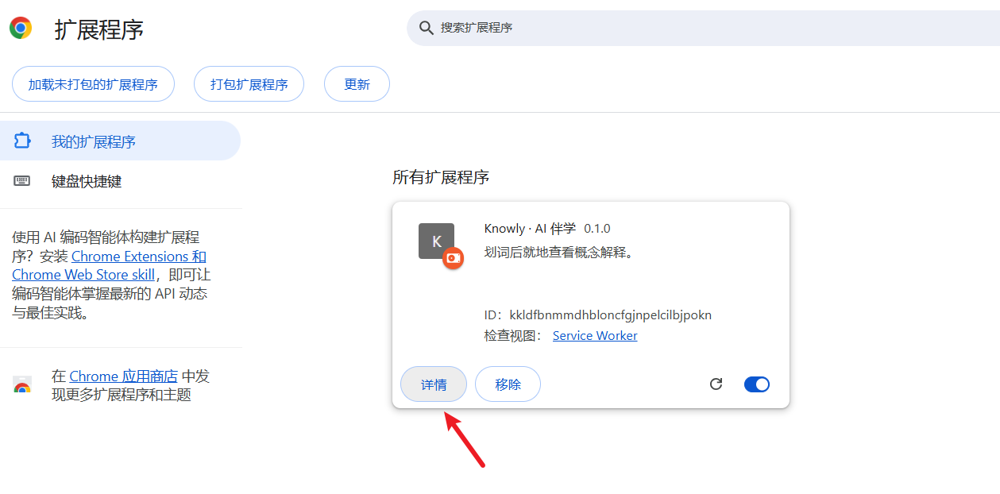

### 5. 进入扩展程序选项

在详情页点击“扩展程序选项”，打开模型配置页面。

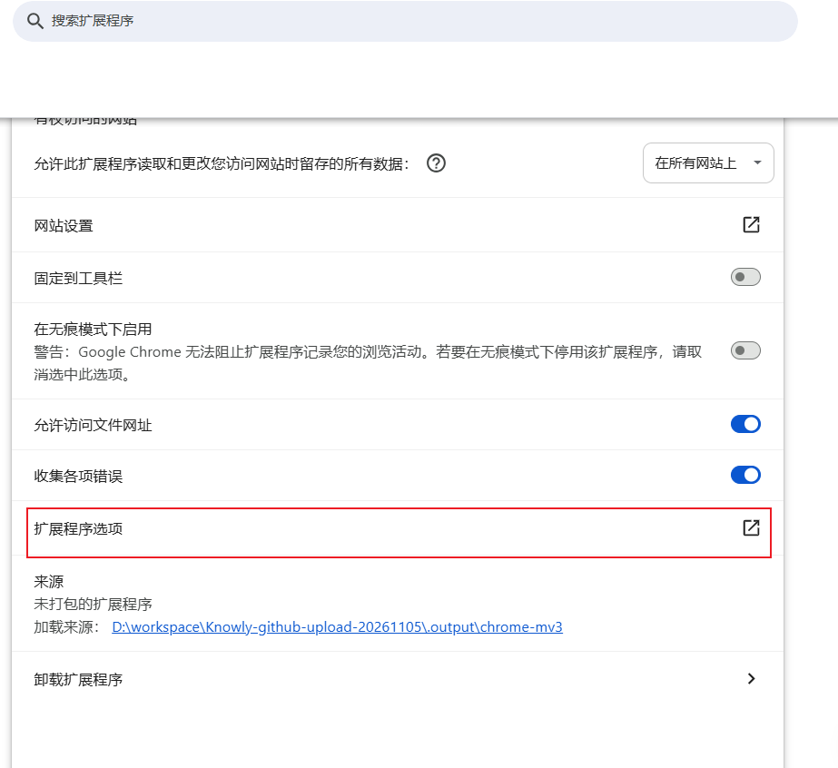

### 6. 选择模型平台与模型 ID

在设置页选择 DeepSeek、智谱 GLM 或豆包，并按模型平台的要求填写模型 ID。

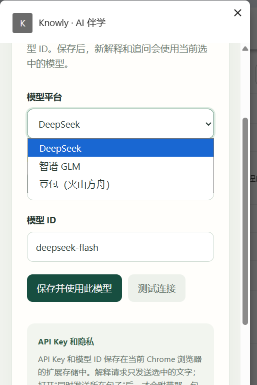

### 7. 测试连接并保存模型配置

填写对应平台签发的 API Key 和模型 ID，点击“测试连接”。连接成功后点击“保存并使用此模型”。示例截图里的 Key 已遮蔽，请勿将真实 Key 放入截图或提交到仓库。

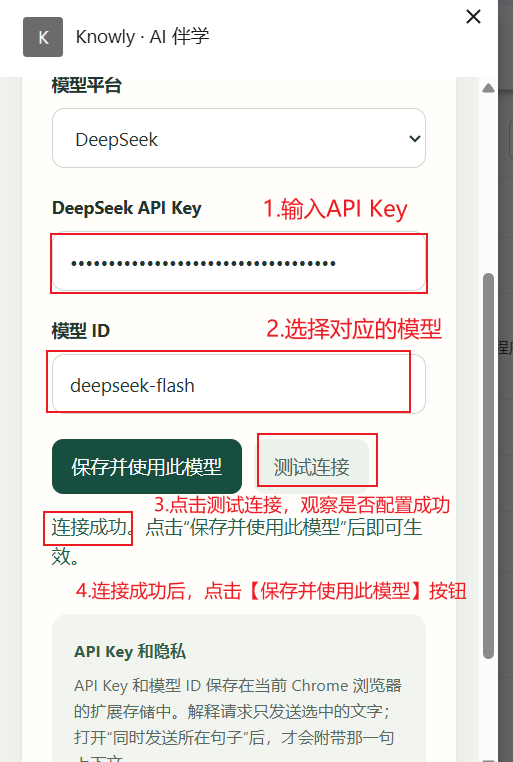

### 8. 继续追问、记录笔记并加入待保存清单

解释卡片支持继续追问和记录个人笔记；可将卡片加入待保存清单，或加入后继续选择其他内容。

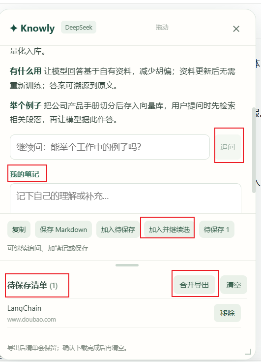

### 9. 管理多张卡片

待保存清单可以收集多张学习卡片。长回答会保留在对应卡片中，可继续查看和导出。

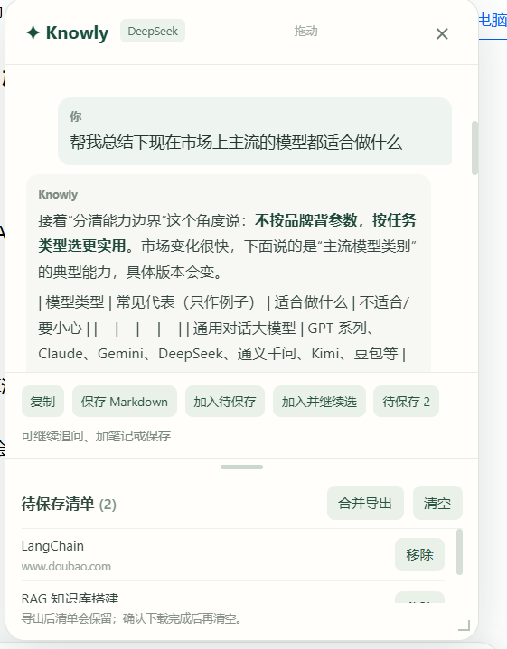

### 10. 在 Chrome 下载记录中确认导出文件

合并导出后，可在 Chrome 下载记录中查看 Markdown 文件及其保存状态。

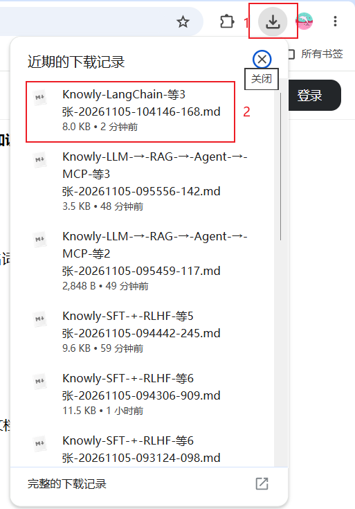

### 11. 查看导出的 Markdown

导出文件包含学习卡片内容，可用本地 Markdown 编辑器或兼容的文档工具打开查看。

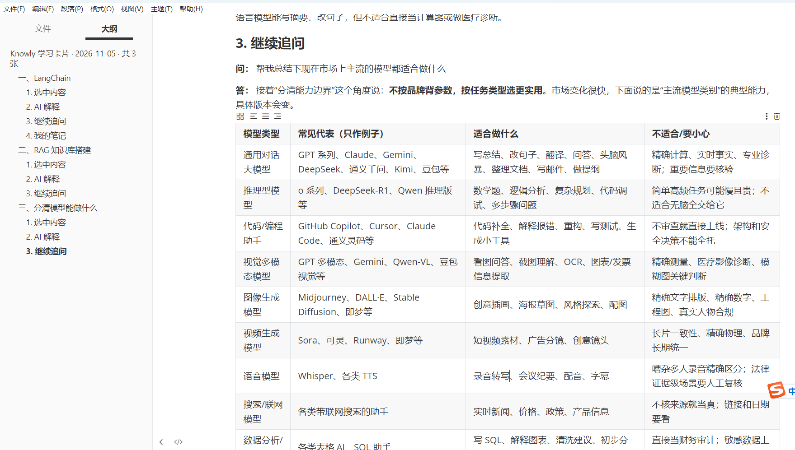

## 环境要求

- Windows 或 macOS 电脑。
- Google Chrome（其他 Chromium 浏览器可能兼容，但本项目目前以 Chrome 为主要目标）。
- Node.js LTS 和 npm，仅在从源码构建时需要。
- 一个支持的模型平台账号，以及由该平台签发的 API Key。

## 安装方式一：下载已构建版本

如果项目提供了 `chrome-mv3` 发布压缩包：

1. 下载并解压压缩包，找到其中包含 `manifest.json` 的 `chrome-mv3` 文件夹。
2. 在 Chrome 地址栏输入 `chrome://extensions` 并按回车。
3. 打开页面右上角的“开发者模式”。
4. 点击“加载已解压的扩展程序”，选择 `chrome-mv3` 文件夹。
5. 安装后，建议将 Knowly 固定到 Chrome 工具栏，方便查看扩展选项。

## 安装方式二：从源码构建

1. 安装 Node.js LTS。安装程序通常会一并安装 npm。
2. 将项目下载到本机并解压，或使用 Git 克隆项目。
3. 在项目文件夹中打开 PowerShell 或终端，运行：

   ```powershell
   npm ci
   npm run build
   ```

4. 等待命令完成。构建产物位于 `.output/chrome-mv3`。
5. 按照上面“安装方式一”的第 2–4 步，在 Chrome 中加载 `.output/chrome-mv3` 文件夹。

## 配置模型

1. 打开 `chrome://extensions`。
2. 找到 Knowly，点击“详细信息”，再打开“扩展程序选项”。
3. 选择 DeepSeek、智谱 GLM 或豆包。
4. 在对应模型平台的控制台创建 API Key，将 Key 粘贴到 Knowly 的 API Key 输入框。
5. 填写模型 ID。豆包通常要求填写控制台提供的 Endpoint ID 或 Model ID；具体值请以模型平台控制台为准。
6. 点击“测试连接”。成功后点击“保存并使用此模型”。

每个模型平台的 Key 和模型 ID 单独保存。切换平台后，需要为该平台配置自己的凭据。模型调用和连接测试可能产生费用，请查看模型平台的定价与用量。

### API Key 与隐私

- API Key 由用户在扩展选项中输入，并保存在当前 Chrome 用户配置的扩展本地存储中；本项目没有自建后端，也不会把 Key 写入源码。
- 不要把 API Key 提交到 GitHub、截图、录屏或分享给他人。发布项目时，使用者应填写自己的 Key。
- 解释请求会把选中的文字发送到当前配置的模型服务商。只有开启“同时发送所在句子”时，才会附带选区所在句子的上下文。
- 请勿发送密码、访问令牌、个人身份信息或其他不适合交给模型服务商处理的内容。使用前请阅读相应服务商的隐私政策。

## 使用方法

1. 打开普通网页，并刷新页面（首次安装或更新扩展后都需要刷新）。
2. 用鼠标拖动选中要理解的词语或句子，最多 200 个字符。
3. 点击选区附近出现的“解释”按钮，等待回答逐步显示。
4. 如需补充上下文，勾选“同时发送所在句子”；默认只发送选中的文字。
5. 在“继续问”输入框输入问题，例如“能举个工作中的例子吗？”，点击追问或按回车。
6. 可在“我的笔记”中记录自己的理解。顶部区域可拖动卡片，右下角手柄可调整大小。
7. 点击“加入待保存”收集卡片；点击“加入并继续选”可收集后继续选择新内容。相同页面和上下文的卡片再次加入时会更新已有卡片。
8. 打开“待保存”清单，可查看或移除卡片，再选择合并导出 Markdown。确认文件已下载后，可自行清空清单。

导出的 Markdown 可以放进 Obsidian Vault 或其他笔记软件。Knowly 不会自动同步文件或清单到其他设备；如需跨设备同步，请使用笔记软件或云盘提供的同步功能。

## 常见问题

**没有出现“解释”按钮**

- 确认 Knowly 已启用，并且当前打开的是普通网页。
- 扩展刚安装或更新后，刷新网页再选中文字。
- 浏览器内置页面（例如扩展管理页）通常不允许扩展注入内容。

**提示 API Key、模型 ID 或连接错误**

- 确认选择的平台与 API Key 来源一致，Key 没有多余空格。
- 确认模型 ID 或豆包 Endpoint ID 在平台控制台中可用。
- 检查平台账号权限、余额、用量限制和网络连接。

**更新扩展后网页功能异常**

先在 `chrome://extensions` 点击 Knowly 的刷新图标，再刷新正在使用的网页。

**找不到导出的 Markdown 文件**

打开 Chrome 下载记录（`chrome://downloads`）查看文件位置。待保存清单在当前浏览器中，不会自动变成文件；需要点击导出。

## 开发

```powershell
npm ci
npm run typecheck
npm run build
npm run dev
```

主要目录：

```text
entrypoints/content/          页面选区按钮和解释卡片
entrypoints/background.ts     模型请求和错误处理
entrypoints/options/          模型及 API Key 设置页
src/services/explanation.ts   模型接口和消息类型
src/services/cards.ts         Markdown 卡片格式和下载
src/selection.ts              选区、上下文和卡片位置
tests/                        Playwright 扩展测试
```

## 当前范围

项目目前以 Chrome Manifest V3 扩展为目标。尚未提供 Chrome Web Store 上架包、在线服务、账号系统或云端笔记同步。公开仓库中的构建产物和依赖目录应由 `.gitignore` 排除；用户的模型 Key 需要在本机浏览器中配置。
